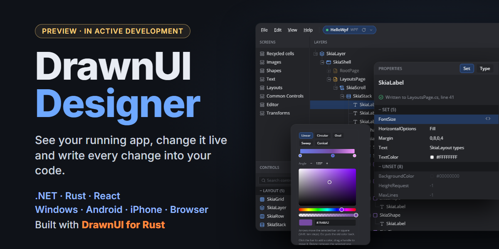

# DrawnUI Designer



> [!NOTE]
> **Preview, in active development.** New features land every week, and the protocol, the MCP tools and the
> settings can still change between versions. Issues and feedback are welcome.

**See your running DrawnUI app, change it live, and write every change into your code.** For DrawnUI apps in
.NET, Rust and React, on Windows, Android, iPhone and in the browser.

- **Desktop app** for Windows and macOS: your app runs in its own window or on a phone, the designer beside it.
- **Inside [DrawFiddle](https://drawfiddle.com):** the Visual view of C#, TSX and Rust snippets is this designer,
  nothing to install.
- **Inside VS Code** as an extension, beside your code.
- **For AI agents** through MCP: the same view and the same edits.

### 🦀 Built with [DrawnUI for Rust](https://github.com/DrawnUi/DrawnUi.Rust)

The designer is itself a DrawnUI app. Every panel, the menu bar, the layers tree, the color and gradient editors are drawn by [DrawnUI for Rust](https://github.com/DrawnUi/DrawnUi.Rust) on one hardware-accelerated Skia canvas, with keyboard and screen reader support. The same Rust code runs as a desktop app for Windows and MacOS, as a VS Code extension and in browser (WebAssembly) inside [DrawFiddle](https://drawfiddle.com).

## What it does

- **Attaches to your running app.** Start your app in Debug and it shows up in the designer by itself, with its
  screens, the control tree of the screen it shows, and the properties of every control.
- **Edit live.** Change a value and the app shows it at once: numbers with − and +, choices from a list, colors
  with a picker, text in place. Undo takes it back.
- **Write to code.** One click writes the value into the C# or TSX file that creates the control. Only that value
  changes; your formatting stays as it was. Undo takes the write back too.
- **Build the screen.** Drag controls from the Controls panel into Layers, or click to place them in the app.
  Copy, paste, duplicate, copy a style, delete, and drag rows to move controls, then write it all to code. Every
  step goes into the undo history (Ctrl+Z, Ctrl+Y).
- **Pick in the app.** Press Pick, then click a control in the app, or tap it on a phone, and it is selected in the
  designer.
- **Phones on the cable.** An Android phone or an iPhone on its USB cable connects the same way, no network
  setup. Apps on other devices can also connect over Wi-Fi with a secret address.
- **For AI agents.** An MCP server gives agents the same view and the same edits: read the tree, take a
  screenshot, set a value, write it to code.

Six themes, six languages (English, Deutsch, Español, Français, Русский, Srpski), and full accessibility: keyboard
(Tab and the arrow keys) and screen readers.

## Get started

**1. Run the designer.** On Windows, download the latest build from
[Releases](https://github.com/DrawnUi/DrawnUi.Designer/releases), unzip it and run `drawnui-designer.exe`; builds for
more platforms follow. Or `cargo run -p designer-desktop --release` from this repository (Rust needed), or the
[VS Code extension](#vs-code).

**2. Add the agent to your app.** It is active in debug and development builds only; release builds carry nothing
of it.

- **.NET (DrawnUi MAUI, WPF):** apps on DrawnUi 1.10.8.15 or newer have it already. Otherwise reference the NuGet
  package [`DrawnUi.Designer.Agent`](https://www.nuget.org/packages/DrawnUi.Designer.Agent). Set
  `DrawnUiDesigner=false` in your project to turn it off.
- **Rust (DrawnUI for Rust):** add the agent crate and wrap your `Ui` where you hand it to `drawnui::run`:

  ```toml
  [dependencies]
  drawnui-designer-agent = { git = "https://github.com/DrawnUi/DrawnUi.Designer" }
  ```

  ```rust
  drawnui::run("My app", || drawnui_designer_agent::attach!(Ui::new(App::default(), build)));
  ```

  `DRAWNUI_DESIGNER=0` turns it off.
- **React (DrawnUi.React):** build the agent package once from a clone of this repository, add it to your app and
  attach it to the canvas:

  ```powershell
  cd agents/react; npm install; npm run build
  cd <your app>; npm i -D <this repository>/agents/react
  ```

  ```tsx
  import { attach } from "drawnui-react-designer-agent";

  <Canvas ref={(c) => { if (c) attach(c, { name: "My app", project: "<folder of your .tsx files>" }); }}>
  ```

  `project` lets Write to code edit your `.tsx` files.
- **In DrawFiddle:** nothing to install. The Visual view is the designer, for C#, TSX and Rust snippets.

**3. Run your app** in Debug (`cargo run`, `npm run dev`). It appears in the designer's title bar. Click a screen to
open it in the app, click a control to select it. Apps you ran before stay in the title bar with a button to run
them again.

The [designer guide](docs/designer.md) covers everything else: attaching without the package, phones, Wi-Fi,
the browser, hot reload, which code the designer can write to, and every MCP tool.

### Which apps

| App | How it connects |
|---|---|
| DrawnUi WPF, DrawnUi MAUI on Windows | On the same computer |
| DrawnUi MAUI on Android | Over the USB cable (the designer sets up adb by itself) |
| DrawnUi MAUI on iPhone and iPad | Over the USB cable, the way the debugger does |
| DrawnUi MAUI on Mac (Mac Catalyst) | On the same Mac; from another computer's designer over Wi-Fi |
| DrawnUI for Rust on Windows | On the same computer: live editing, Pick, snapshots and Bring to front, also while minimized; Write to code into the crate's `.rs` files |
| DrawnUI for Rust in the browser | From the page, with the agent built in (`agents/rust`): live editing, Pick, adding, copying, moving (also into another control) and deleting controls, snapshots; inside DrawFiddle through the page, with Write to code into the snippet |
| DrawnUI for React (DrawnUi.React) in the browser | From the page, in development builds: live editing, Pick, adding, copying and deleting controls, snapshots, Write to code into `.tsx`; inside DrawFiddle through the page |
| Any of them on another device | Over Wi-Fi: Settings, Connection, Apps on other devices |

With `dotnet watch` on Windows, code you change by hand or with an AI agent shows in the open screen by itself.

### When an app doesn't show up

The status line at the bottom says where the designer is listening, for example
`Hub connected · 1 app · Wi-Fi off · USB: 1 iPhone`.

- **The phone isn't listed under USB:** plug it in again, and unlock it once.
- **An iPhone app that was in the background or behind the lock screen** shows up again by itself within a few
  seconds of coming back to the front, under the same id. If it doesn't, start it again.
- **An app on Wi-Fi:** "Apps on other devices" must be on (Settings, Connection), and the app must have been built
  with the address shown there.
- **Only Debug builds** carry the agent; a Release build never shows up.

### What the agent does in your app

Nothing until a designer connects: no work on the UI thread and no event hooks, only a quiet connection attempt in
the background. It connects only to your own designer, never to the internet, and sends only your app's own
screens, controls and screenshots when the designer asks. One console line at start says it is waiting.

## VS Code

**DrawnUI: Open Designer** in the Command Palette opens the designer beside your code, for Windows.

- **From Releases:** download `drawnui-designer-0.4.0.vsix` from
  [Releases](https://github.com/DrawnUi/DrawnUi.Designer/releases), then in VS Code run **Extensions: Install from
  VSIX...**, or:

  ```powershell
  code --install-extension drawnui-designer-0.4.0.vsix
  ```

- **From the Marketplace** (once it is published there): search the Extensions view for **DrawnUI Designer**, or
  `code --install-extension drawnui.drawnui-designer`.

The panel has the window's menu bar, keys and Settings, and shares the window's settings. While it is the active
tab, its own keys (Ctrl+P Pick, Ctrl+R Restart, Ctrl+, Settings, F1 Help, Alt+F / Alt+E menus) are its, not VS Code's.
Closing the panel with changes not in code keeps them live in the app and says so, with **Reopen**.
Settings: `drawnuiDesigner.port` (default 54270) and `drawnuiDesigner.sidecarPath`. To build the .vsix yourself,
see [Build from source](#build-from-source).

## Use it with AI

An AI agent works on your running app the way you do in the window: it opens a screen, finds the control you
mean (or the one you point at in a screenshot), tries a value live, writes it into your code, and takes a
screenshot to check the result. Ask it things like "make the title on the Settings screen bigger and write it to
code" while the app runs.

1. **Connect the agent to the designer.** The designer serves MCP at `http://127.0.0.1:54271/mcp` while it runs.
   Claude Code:

   ```powershell
   claude mcp add --transport http drawnui-designer http://127.0.0.1:54271/mcp
   ```

   Settings, Connection shows the same address and command with copy buttons.
2. **Give it the skill.** The [drawnui-designer skill](docs/skills/drawnui-designer/SKILL.md) teaches the agent the
   tools, the workflow, and what to do when a value cannot be written to code. Load it with
   the [drawnui](https://drawnui.net/skills/drawnui/SKILL.md) and
   [drawnui-fluent](https://drawnui.net/skills/drawnui-fluent/SKILL.md) skills; the full list is in
   [AI skills](https://drawnui.net/articles/ai-skills.html).

## Build from source

```powershell
cargo build -p designer-desktop --release          # the designer (Windows, macOS)
dotnet build agents\dotnet\Agent -c Release         # the in-app agent
```

The VS Code extension (needs the `wasm32-unknown-emscripten` Rust target, emsdk and Node.js):

```powershell
cargo build -p designer-desktop --release
New-Item -ItemType Directory -Force vscode\bin | Out-Null
Copy-Item target\release\drawnui-designer.exe vscode\bin\
$env:EMSDK = "<emsdk folder>"
cd vscode
npm ci
npm run media
npm run package
```

## Inside this repository

| Folder | What it is |
|---|---|
| `crates/designer-desktop` | The designer window, drawn with DrawnUI for Rust |
| `crates/designer-core` | The hub every app and editor connects to: phones on the cable, Wi-Fi devices, running apps, MCP |
| `crates/designer-sources` | Reads fluent DrawnUI C# and turns edits into text changes that keep your formatting |
| `crates/designer-protocol` | The messages between apps, the hub and editors |
| `crates/designer-i18n` | The designer's texts in six languages |
| `crates/designer-hubcore` | The hub's logic without sockets, shared by the desktop and the browser build |
| `agents/dotnet` | The agent inside DrawnUi .NET apps and its NuGet package |
| `agents/rust` | The agent inside DrawnUI for Rust apps |
| `agents/react` | The agent inside DrawnUi.React apps |
| `vscode` | The VS Code extension |
| `docs` | The [designer guide](docs/designer.md) |

## License

MIT, see [LICENSE](LICENSE).
